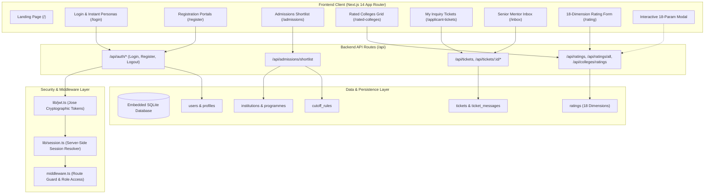
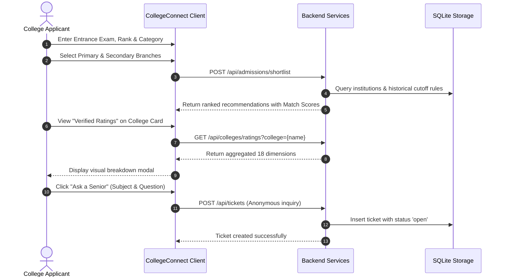
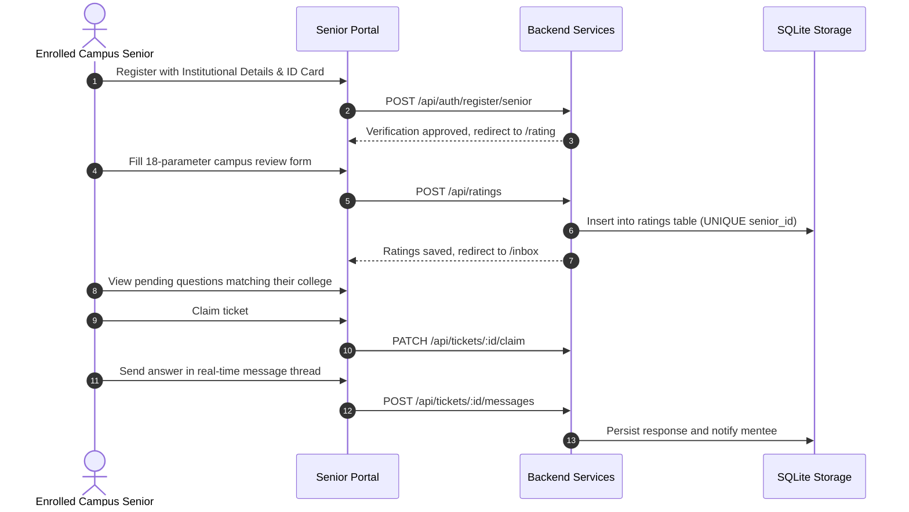

# CollegeConnect

<div align="center">


**Find your college. Know its reality. Connect with verified campus seniors.**

[](https://nextjs.org/)
[](https://react.dev/)
[](https://www.typescriptlang.org/)
[](https://tailwindcss.com/)
[](https://sqlite.org/)
[](https://github.com/panva/jose)
[](https://github.com/dcodeIO/bcrypt.js)
[](LICENSE)

[Features](#core-features) • [System Architecture](#system-architecture) • [Rating System](#18-parameter-campus-evaluation-engine) • [Database Schema](#database-schema--relational-design) • [API Documentation](#api-documentation) • [Local Setup](#quick-start--local-setup) • [Demo Personas](#demo-personas--walkthrough)

</div>

---

## Overview

**CollegeConnect** is an end-to-end, student-centric college discovery and counseling platform built for Indian engineering aspirants. 

Navigating college choices during JoSAA, CSAB, and private university counseling is notoriously difficult. Aspirants face fragmented cutoff reports, misleading institutional brochures, and contradictory forum posts. CollegeConnect bridges this trust deficit through three interconnected pillars:

1. **Deterministic Rank Feasibility Engine:** Evaluates candidate ranks and categories against historical JoSAA/CSAB cutoffs and institutional eligibility baselines.
2. **18-Parameter Verified Campus Evaluation Engine:** Aggregates ground-truth student ratings submitted by verified, enrolled seniors across 18 objective campus dimensions.
3. **Anonymous Peer Mentorship State Machine:** Directly routes applicant questions to verified seniors from specific target colleges through a private, real-time ticket messaging thread.

---

## The Problem & The Solution

```
┌────────────────────────────────────────────────────────┐
│                      THE PROBLEM                       │
├──────────────────────────┬─────────────────────────────┤
│   Fragmented Cutoffs     │ Confusing multi-page PDFs,  │
│                          │ inconsistent category ranks │
├──────────────────────────┼─────────────────────────────┤
│   Brochure Exaggeration  │ 100% placement claims,      │
│                          │ sugarcoated campus reality  │
├──────────────────────────┼─────────────────────────────┤
│  Unverified Online Advice │ Anonymously posted rumors,  │
│                          │ coaching institute biases   │
└──────────────────────────┴─────────────────────────────┘
                            ▼
┌────────────────────────────────────────────────────────┐
│                 COLLEGECONNECT SOLUTION                │
├──────────────────────────┬─────────────────────────────┤
│   Mathematical Bounds    │ Precise cutoff filtering,   │
│                          │ Safe/Competitive/Borderline │
├──────────────────────────┼─────────────────────────────┤
│  18-Parameter Evaluation │ Ground reality: mess, fests,│
│                          │ coding culture, bureaucracy │
├──────────────────────────┼─────────────────────────────┤
│   Verified Peer Threads  │ Real enrolled students,     │
│                          │ 100% applicant anonymity    │
└──────────────────────────┴─────────────────────────────┘
```

---

## Core Features

### 1. Admissions Shortlist & Smart Matchmaking
- **Dual Branch Preference:** Filter by primary and secondary engineering disciplines (CSE, IT, ECE, AI/ML, Data Science, Mechanical, Electrical, Civil, and more).
- **Public & Private Coverage:** Blends JoSAA/CSAB institutes (IITs, NITs, IIITs, GFTIs) and top-tier private engineering universities (BITS Pilani, VIT Vellore, MIT Manipal, LNMIIT, Thapar, JIIT Noida, RVCE).
- **Match Score & Tiers:** Every recommendation receives a Match Score (0–100) and an admission feasibility tag:
  - `Safe` (High probability of admission based on historical closing cutoffs)
  - `Competitive` (Realistic shot within historical rank volatility)
  - `Borderline` (Reach institution requiring favorable counseling spot rounds)
- **Cohort Analysis:** Concise qualitative summaries highlighting batch talent density, coding culture, and placement stability.

### 2. Automated Senior Campus ID Verification
- Enrolled college seniors verify their identity via institutional document verification.
- Validates the student's college, degree branch, and expected graduation year.
- Upon successful verification, the senior is designated as a **Verified Senior**, unlocking peer mentorship and campus rating permissions.

### 3. 18-Parameter Campus Evaluation Engine
- Verified seniors evaluate their campus across 18 granular, real-world criteria on a 1-to-5 scale.
- Multi-dimensional aggregation uses `ROUND(AVG(...), 1)` to provide mathematically reliable insights.
- Applicants view aggregated ratings directly on college cards and via a dedicated, searchable directory.

### 4. Rated Colleges Directory (`/rated-colleges`)
- A dedicated applicant dashboard presenting all community-evaluated colleges in a responsive 3-column card grid.
- Instant search filtering by institution name.
- Highlights four key indicators on each card: Academics, Placements, Coding Culture, and Campus Life.
- Launches the interactive 18-parameter breakdown modal with visual color-coded progress bars.

### 5. Anonymous Peer Mentorship Tickets
- Applicants open targeted inquiry tickets for any college on their shortlist.
- Tickets are routed directly to the inbox of verified seniors enrolled in that specific institution.
- Full privacy preservation: Applicant identities remain completely anonymous.
- Bi-directional conversation thread supporting back-and-forth messaging and ticket status lifecycle (`open` -> `claimed` -> `resolved`).

### 6. Instant 1-Click Persona Login
- Pre-configured login personas allow immediate testing without registration:
  - **Arnav Nandchahal** (`nandchahal.arnav@gmail.com`) — Applicant with saved shortlists and tickets.
  - **Rahul Sharma** (`applicant@collegeconnect.com`) — Demo applicant persona.
  - **Aman Verma** (`senior@iitb.ac.in`) — Verified IIT Bombay Senior persona.

---

## System Architecture



---

## User Workflows

### Applicant Workflow


### Verified Senior Workflow


---

## 18-Parameter Campus Evaluation Engine

Every verified senior rates their college across 18 distinct parameters grouped into four critical categories:

| Category | Parameter | Description |
| :--- | :--- | :--- |
| **Academics & Career** | `academics` | Syllabus depth, curriculum modernity, exam fairness, and research opportunities. |
| | `faculty` | Professor accessibility, teaching quality, and supportive mentorship. |
| | `placements` | Company visitation, median and average packages, and tier-1 recruitment volume. |
| | `internships` | Summer internships, industrial training linkages, and stipend opportunities. |
| **Campus Culture** | `coding_culture` | Competitive programming, open-source communities, and hackathon culture. |
| | `peer_group` | Talent density, batch drive, alumni network engagement, and mutual ambition. |
| | `campus_life` | Vibrant energy, personal freedom, gender diversity, and campus social environment. |
| | `clubs` | Active student bodies covering technology, arts, debate, robotics, and social service. |
| | `fests` | Annual cultural and technical fests, scale, star nights, and student autonomy. |
| | `sports` | Sports fields, gymnasium facilities, indoor courts, and inter-college tournaments. |
| **Living & Facilities** | `infrastructure` | Air-conditioned lecture halls, computing labs, high-speed Wi-Fi, and library. |
| | `hostel` | Room cleanliness, occupancy ratios, washroom maintenance, and power backup. |
| | `mess` | Food hygiene, nutritional balance, canteen choices, and drinking water safety. |
| | `location` | Proximity to metro/airports, IT/tech corridors, city recreation, and safety. |
| | `safety` | 24/7 campus security surveillance, female safety protocols, and emergency medical center. |
| **Governance & Value** | `administration` | Administrative efficiency, student grievance redressal, and policy transparency. |
| | `fees` | Return on Investment (ROI) comparing overall cost against learning and career outcomes. |
| | `overall` | Holistic rating representing the cumulative experience at the institution. |

### Aggregation Math
Averages are calculated dynamically using SQLite aggregate functions:
```sql
SELECT 
  college AS collegeName,
  COUNT(id) AS total_reviews,
  ROUND(AVG(overall), 1) AS overall,
  ROUND(AVG(academics), 1) AS academics,
  ROUND(AVG(faculty), 1) AS faculty,
  ROUND(AVG(placements), 1) AS placements,
  ROUND(AVG(internships), 1) AS internships,
  ROUND(AVG(hostel), 1) AS hostel,
  ROUND(AVG(mess), 1) AS mess,
  ROUND(AVG(campus_life), 1) AS campus_life,
  ROUND(AVG(peer_group), 1) AS peer_group,
  ROUND(AVG(infrastructure), 1) AS infrastructure,
  ROUND(AVG(clubs), 1) AS clubs,
  ROUND(AVG(fests), 1) AS fests,
  ROUND(AVG(coding_culture), 1) AS coding_culture,
  ROUND(AVG(sports), 1) AS sports,
  ROUND(AVG(administration), 1) AS administration,
  ROUND(AVG(fees), 1) AS fees,
  ROUND(AVG(location), 1) AS location,
  ROUND(AVG(safety), 1) AS safety
FROM ratings
GROUP BY college
ORDER BY overall DESC;
```

---

## Database Schema & Relational Design

The application utilizes an embedded SQLite relational database (`better-sqlite3`) optimized with write-ahead logging (WAL).

```
 ┌──────────────────────┐           ┌──────────────────────┐
 │        users         │ 1       1 │       profiles       │
 ├──────────────────────┼───────────┼──────────────────────┤
 │ id (TEXT PK)         │           │ user_id (TEXT FK)    │
 │ email (TEXT UNIQUE)  │           │ display_name (TEXT)  │
 │ password_hash (TEXT) │           │ college (TEXT)       │
 │ role (TEXT)          │           │ is_verified (INTEGER)│
 │ created_at (INTEGER) │           │ branch (TEXT)        │
 └──────────┬───────────┘           └──────────────────────┘
            │ 1
            │
            ├─────────────────────────┐
            │ 1                       │ 1
 ┌──────────▼───────────┐  ┌──────────▼───────────┐
 │       ratings        │  │       tickets        │
 ├──────────────────────┤  ├──────────────────────┤
 │ id (INTEGER PK)      │  │ id (TEXT PK)         │
 │ senior_id (TEXT UNQ) │  │ applicant_id (FK)    │
 │ college (TEXT)       │  │ target_college (TEXT)│
 │ academics (INTEGER)  │  │ status (TEXT)        │
 │ faculty (INTEGER)    │  │ claimed_by (FK)      │
 │ placements (INTEGER) │  │ created_at (INTEGER) │
 │ ... (18 Dimensions)  │  └──────────┬───────────┘
 └──────────────────────┘             │ 1
                                      │
                           ┌──────────▼───────────┐
                           │   ticket_messages    │
                           ├──────────────────────┤
                           │ id (TEXT PK)         │
                           │ ticket_id (TEXT FK)  │
                           │ sender_id (TEXT FK)  │
                           │ message (TEXT)       │
                           │ created_at (INTEGER) │
                           └──────────────────────┘
```

### Table Definitions

#### `users`
| Column | Type | Constraints | Description |
| :--- | :--- | :--- | :--- |
| `id` | TEXT | PRIMARY KEY | Unique user identifier (`user-app-...` or `user-snr-...`) |
| `email` | TEXT | UNIQUE, NOT NULL | Account email address |
| `password_hash` | TEXT | NOT NULL | Salted bcrypt password hash |
| `role` | TEXT | NOT NULL | `applicant` or `student` (verified senior) |
| `created_at` | INTEGER | NOT NULL | Unix epoch timestamp in milliseconds |

#### `profiles`
| Column | Type | Constraints | Description |
| :--- | :--- | :--- | :--- |
| `user_id` | TEXT | PRIMARY KEY, FK -> `users(id)` | Linked user account |
| `display_name` | TEXT | NOT NULL | User's full name |
| `verified_status` | INTEGER | DEFAULT 0 | 1 if senior is verified, else 0 |
| `is_verified` | INTEGER | DEFAULT 0 | Verification status flag |
| `college` | TEXT | NULLABLE | Enrolled institution (for seniors) |
| `branch` | TEXT | NULLABLE | Engineering branch/discipline |
| `grad_year` | TEXT | NULLABLE | Expected graduation year |

#### `ratings`
| Column | Type | Constraints | Description |
| :--- | :--- | :--- | :--- |
| `id` | INTEGER | PRIMARY KEY AUTOINCREMENT | Unique rating identifier |
| `senior_id` | TEXT | UNIQUE, FK -> `users(id)` | Enforces single review per senior |
| `college` | TEXT | NOT NULL | Name of the evaluated college |
| `academics` .. `overall` | INTEGER | NOT NULL, CHECK(1..5) | 18 evaluated campus dimensions |
| `created_at` | INTEGER | NOT NULL | Submission timestamp |

#### `tickets`
| Column | Type | Constraints | Description |
| :--- | :--- | :--- | :--- |
| `id` | TEXT | PRIMARY KEY | Unique ticket identifier |
| `applicant_id` | TEXT | NOT NULL, FK -> `users(id)` | Inquiring applicant identifier |
| `target_college` | TEXT | NOT NULL | College receiving the inquiry |
| `target_branch` | TEXT | NULLABLE | Branch specific question context |
| `subject` | TEXT | NOT NULL | Short summary of inquiry |
| `status` | TEXT | NOT NULL | `open`, `claimed`, or `resolved` |
| `claimed_by` | TEXT | NULLABLE, FK -> `users(id)` | Assigned senior mentor |
| `created_at` | INTEGER | NOT NULL | Creation timestamp |

#### `ticket_messages`
| Column | Type | Constraints | Description |
| :--- | :--- | :--- | :--- |
| `id` | TEXT | PRIMARY KEY | Unique message identifier |
| `ticket_id` | TEXT | NOT NULL, FK -> `tickets(id)` | Parent ticket thread |
| `sender_id` | TEXT | NOT NULL, FK -> `users(id)` | Message author |
| `sender_role` | TEXT | NOT NULL | `applicant` or `student` |
| `message` | TEXT | NOT NULL | Message body text |
| `created_at` | INTEGER | NOT NULL | Timestamp |

---

## API Documentation

All endpoints return standard JSON responses and enforce appropriate session authorization.

### Authentication Endpoints

#### `POST /api/auth/login`
Authenticates an applicant or senior mentor.
- **Request Body:**
```json
{
  "email": "nandchahal.arnav@gmail.com",
  "password": "Hans@3481"
}
```
- **Response (`200 OK`):**
```json
{
  "success": true,
  "message": "Login successful.",
  "redirectTo": "/admissions",
  "user": {
    "userId": "user-app-1793216531825-tajef",
    "email": "nandchahal.arnav@gmail.com",
    "role": "applicant",
    "displayName": "Arnav Nandchahal"
  }
}
```

#### `POST /api/auth/register/applicant`
Registers a new prospective college applicant.
- **Request Body:**
```json
{
  "fullName": "Priya Patel",
  "email": "priya@example.com",
  "password": "Password123"
}
```
- **Response (`201 Created`):**
```json
{
  "success": true,
  "redirectTo": "/admissions"
}
```

#### `POST /api/auth/register/senior`
Registers and verifies an enrolled senior mentor using campus credentials.
- **Request Body:**
```json
{
  "fullName": "Rohit Verma",
  "email": "rohit.v@iitb.ac.in",
  "password": "Password123",
  "college": "Indian Institute of Technology Bombay",
  "branch": "Computer Science and Engineering",
  "gradYear": "2026",
  "idCardBase64": "data:image/png;base64,..."
}
```
- **Response (`200 OK`):**
```json
{
  "success": true,
  "redirectTo": "/rating"
}
```

#### `POST /api/auth/logout`
Terminates the session and clears all security cookies.
- **Response (`303 See Other`):** Clears `auth_session` cookie and redirects to `/login`.

---

### Ratings & Aggregations Endpoints

#### `GET /api/ratings/all`
Fetches all community-evaluated colleges with aggregated metrics across all 18 parameters.
- **Auth:** Requires active logged-in session.
- **Response (`200 OK`):**
```json
{
  "success": true,
  "colleges": [
    {
      "collegeName": "IIT Bombay",
      "total_reviews": 1,
      "overall": 5.0,
      "academics": 5.0,
      "faculty": 4.0,
      "placements": 5.0,
      "internships": 4.0,
      "hostel": 3.0,
      "mess": 3.0,
      "campus_life": 5.0,
      "peer_group": 5.0,
      "infrastructure": 4.0,
      "clubs": 5.0,
      "fests": 5.0,
      "coding_culture": 5.0,
      "sports": 4.0,
      "administration": 3.0,
      "fees": 4.0,
      "location": 5.0,
      "safety": 5.0
    }
  ]
}
```

#### `GET /api/colleges/ratings?college={name}`
Returns aggregated 18-parameter ratings for a specific college.
- **Response (`200 OK`):**
```json
{
  "hasRatings": true,
  "college": "IIT Bombay",
  "total_reviews": 1,
  "ratings": {
    "academics": 5.0,
    "faculty": 4.0,
    "placements": 5.0,
    "internships": 4.0,
    "hostel": 3.0,
    "mess": 3.0,
    "campus_life": 5.0,
    "peer_group": 5.0,
    "infrastructure": 4.0,
    "clubs": 5.0,
    "fests": 5.0,
    "coding_culture": 5.0,
    "sports": 4.0,
    "administration": 3.0,
    "fees": 4.0,
    "location": 5.0,
    "safety": 5.0,
    "overall": 5.0
  }
}
```

#### `POST /api/ratings`
Submits an 18-parameter evaluation from an authenticated verified senior.
- **Auth:** Requires `student` role.
- **Request Body:**
```json
{
  "academics": 5,
  "faculty": 4,
  "placements": 5,
  "internships": 4,
  "hostel": 3,
  "mess": 3,
  "campus_life": 5,
  "peer_group": 5,
  "infrastructure": 4,
  "clubs": 5,
  "fests": 5,
  "coding_culture": 5,
  "sports": 4,
  "administration": 3,
  "fees": 4,
  "location": 5,
  "safety": 5,
  "overall": 5
}
```
- **Response (`200 OK`):**
```json
{
  "success": true,
  "redirectTo": "/inbox"
}
```

---

### Admissions & Ticketing Endpoints

#### `POST /api/admissions/shortlist`
Computes admission feasibility, match score, and cohort reviews for a given rank and branch preference.
- **Request Body:**
```json
{
  "exam": "JEE Main",
  "rank": 8500,
  "category": "OPEN",
  "homeState": "Maharashtra",
  "primaryBranch": "Computer Science and Engineering",
  "secondaryBranch": "Information Technology"
}
```

#### `POST /api/tickets`
Creates an anonymous peer inquiry ticket.
- **Auth:** Requires `applicant` role.
- **Request Body:**
```json
{
  "targetCollege": "Indian Institute of Technology Bombay",
  "targetBranch": "Computer Science and Engineering",
  "subject": "Hostel facilities and coding culture reality",
  "initialMessage": "Hi, I am deciding between IITB EE and IITD CSE. How active is the competitive programming club for non-CSE branches?"
}
```

#### `GET /api/tickets/:id/messages`
Retrieves the real-time message history of an active ticket.

#### `POST /api/tickets/:id/messages`
Sends a reply in an active inquiry thread.

#### `PATCH /api/tickets/:id/claim`
Enables a verified senior to claim an open inquiry ticket from their college.

---

## Folder Structure

```
CollegeConnect/
├── app/
│   ├── admissions/               # Applicant shortlist dashboard
│   ├── api/                      # Backend API Route Handlers
│   │   ├── admissions/shortlist/ # Cutoff calculation & matching engine
│   │   ├── auth/                 # Login, Applicant/Senior Register, Logout
│   │   ├── colleges/             # College rating query & availability
│   │   ├── ratings/              # Senior rating submission & directory fetch
│   │   └── tickets/              # Peer mentorship tickets & messaging
│   ├── applicant-tickets/        # Applicant ticket tracking & chat view
│   ├── inbox/                    # Verified senior mentor inbox & claim queue
│   ├── login/                    # Login page with 1-click persona switchers
│   ├── rated-colleges/           # 18-parameter community rating directory
│   ├── rating/                   # Senior 18-dimension campus evaluation form
│   ├── register/                 # Separate applicant and senior signup portals
│   ├── globals.css               # Tailwind CSS theme configurations
│   ├── layout.tsx                # Dynamic root layout with authenticated nav
│   └── page.tsx                  # Public landing page
├── components/
│   ├── AdmissionsDashboard.tsx   # Interactive applicant rank filter & results
│   ├── ApplicantTicketsView.tsx  # Applicant ticket list and thread launcher
│   ├── RatedCollegesView.tsx     # 3-column community rated colleges grid
│   ├── RatingModal.tsx           # Modal breakdown displaying 18 parameters
│   ├── RespondentInbox.tsx       # Senior ticket queue and claims management
│   ├── SignOutButton.tsx         # Universal cache-breaking sign-out button
│   └── TicketChat.tsx            # Real-time encrypted messaging UI
├── lib/
│   ├── auth.ts                   # Password verification & salt handling
│   ├── date.ts                   # Deterministic SSR-safe date formatting
│   ├── db.ts                     # Database connection initialization
│   ├── jwt.ts                    # Jose JWT token signing & verification
│   └── session.ts                # Server Component session resolver
├── scripts/
│   └── init_db.js                # Database initialization & seed script
├── types/
│   └── index.ts                  # Shared TypeScript interfaces & types
├── middleware.ts                 # Role-based route guard middleware
├── tailwind.config.ts            # Tailwind CSS styling configuration
├── tsconfig.json                 # TypeScript strict compiler config
└── package.json                  # Dependencies and project run scripts
```

---

## Quick Start & Local Setup

### Prerequisites
- **Node.js:** `v18.17.0` or higher
- **Package Manager:** `npm` (v9+) or `yarn`

### 1. Clone the Repository
```bash
git clone https://github.com/arnav1308/CollegeConnect.git
cd CollegeConnect
```

### 2. Install Dependencies
```bash
npm install
```

### 3. Initialize & Seed the SQLite Database
Initializes the SQLite schema (`database.sqlite`), creates all 8 tables, indexes cutoff boundaries, and seeds test personas and sample reviews:
```bash
npm run init-db
```

### 4. Configure Environment Variables
Create a `.env.local` file in the root directory:
```env
# Optional: Set your Gemini API key for dynamic reasoning summaries
GEMINI_API_KEY=your_gemini_api_key_here
```

### 5. Launch the Development Server
```bash
npm run dev
```

Open [http://localhost:3000](http://localhost:3000) in your web browser.

### 6. Production Build
```bash
npm run build
npm start
```

---

## Demo Personas & Walkthrough

For rapid assessment and grading, CollegeConnect includes pre-seeded test accounts accessible directly on `/login`:

| Persona | Role | Email | Password | Primary Destination | Key Features Accessible |
| :--- | :--- | :--- | :--- | :--- | :--- |
| **Arnav Nandchahal** | Applicant | `nandchahal.arnav@gmail.com` | `Hans@3481` | `/admissions` | Personalized shortlists, active inquiry tickets, rated colleges directory |
| **Rahul Sharma** | Applicant | `applicant@collegeconnect.com` | `password123` | `/admissions` | Clean applicant experience, test inquiry ticket generation |
| **Aman Verma** | Verified Senior | `senior@iitb.ac.in` | `password123` | `/inbox` | Senior ticket claim queue, live chat responses, `/rating` campus review |

---

## Security & Privacy Considerations

- **Strict Anonymity:** When applicants submit inquiry tickets to senior mentors, their user ID, email address, and personal profile are stripped. Senior mentors only view the inquiry subject, target branch, and question content.
- **HttpOnly Cookies:** Authentication sessions use secure, HttpOnly, SameSite-protected JWT cookies, preventing XSS-based session extraction.
- **Password Protection:** User passwords are encrypted using salted `bcryptjs` with standard computational difficulty.
- **SQL Injection Prevention:** All database operations utilize parameterized prepared statements through `better-sqlite3`.
- **Cache-Busting Transitions:** Login and logout actions enforce hard document reloads to purge stale Next.js App Router server caches.

---

## License

This project is licensed under the [MIT License](LICENSE).
